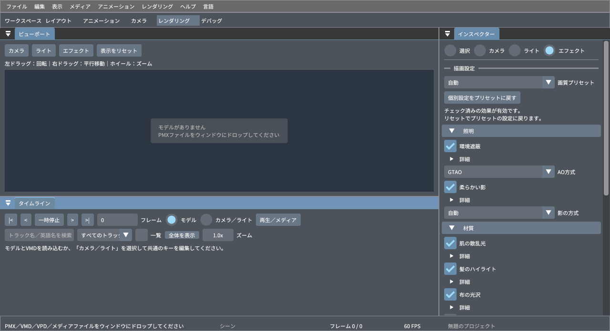
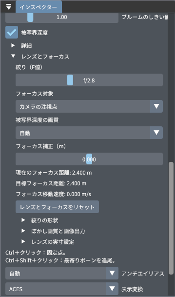
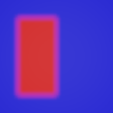
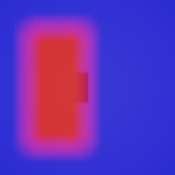

# Preview render effects

Open **Effects** in the viewport toolbar, or switch to the **Render** workspace.
The Inspector groups settings into Lighting, Materials and Post processing.
The controls apply to the Vulkan Preview renderer and Preview exports.



[English panel screenshot](render-settings-en.png)

## Presets and overrides

Auto uses Performance on an integrated GPU/APU and Balanced on a discrete GPU;
`--preview-quality high` selects High. Performance keeps character shading,
GTAO, PCF shadows, Bloom and FXAA, but skips Clearcoat and depth of field.
Balanced adds Clearcoat and PCSS. High also enables depth of field.

A checkbox shows the resolved effect state. Changing it creates an explicit
On/Off override without changing the selected preset. The adjacent Reset button
restores that effect's preset state and intensity. Reset effect overrides resets
all effect overrides, shadow filter and anti-aliasing to their preset defaults.
Color management and AO method are separate choices. Off for anti-aliasing
really disables it; Auto inherits the preset. Zero intensity is supported.

Still-quality exports select High only when the preset is Auto. Explicit presets
and effect overrides survive export. Settings are stored in the optional
`mikumikudesu.renderSettings` object of `.dayo` version 3 files. Older projects
retain ACES, legacy SSAO, PCF and no new Bloom/FXAA/DoF; the new settings can be
selected after loading. Unknown effect fields survive save/load. Invalid enums
fall back safely, and numeric values are checked for finiteness and clamped.

## Effects and limitations

| Control | Implementation | Scope |
| --- | --- | --- |
| AO | Four slice GTAO horizon search in reconstructed view space, analytic cosine integral, depth/normal bilateral denoising; legacy SSAO selectable | Screen-space geometry only; fixed 0.15 scene-unit radius, reduced resolution follows device quality |
| Skin scattering | Wrapped/transmitted skin lighting plus screen-space RGB diffusion of a separate skin **diffuse-only** HDR attachment | Skin preset; depth and skin masks reject non-skin samples; opaque skin only; requires independent attachment blending |
| Hair highlights | Two shifted Kajiya–Kay lobes with UV-derivative tangent fallback | Hair preset; no direction texture |
| Cloth sheen | Charlie distribution tinted by base color | Cloth preset |
| Clearcoat | Additional dielectric GGX lobe with base-lobe attenuation | Plastic and Glass presets; does not add glass refraction |
| Soft shadows | PCF or PCSS blocker search and bounded variable filter radius | Existing directional shadow map/projection; no contact ray tracing |
| Bloom | Half-resolution threshold prefilter and separable Gaussian blur before tone mapping | Three compute dispatches; skipped when disabled; no spectral glare |
| View transform | ACES fit, compact AgX approximation, or Khronos PBR Neutral | SDR linear sRGB output followed by hardware sRGB transfer; not Blender OCIO/LUT parity |
| Exposure / white balance | EV gain and normalized Planckian RGB white-point correction | Approximate white balance, neutral at 6500 K |
| Anti-aliasing | Off / FXAA / Auto | Spatial filter; no temporal history |
| Depth of field | Thin-lens signed CoC, depth-aware MIP/ring gathers, near coverage, motion-reprojected history | F-number, bone/face/eye tracking, static point/nearest-bone tracking clicks, curved aperture blades; perspective camera |

Skin diffuse is separate from specular highlights and hair, so diffusion does
not smear the final scene image. Transparent overlays and outlines erase the
skin mask where they draw; this conservatively leaves these boundaries sharp.
The low-cost transmission approximation also remains useful for backlit skin.
Screen-space effects cannot recover hidden or off-screen geometry. SSR, SSGI,
general TAA, refractive glass and real-time highlight scatter remain separate work.

The previous-frame background mode uses the direct shading path. Color
management and material lighting still apply, but HDR postprocessing is bypassed
in that mode. Normal previews and exported frames use the HDR path.

## Lens and focus



[English lens controls](lens-controls-en.png)

Enable **Depth of field**, then open **Lens and focus**. Aperture is an F-number:
opening from f/5.6 to f/1.4 multiplies the uncapped blur radius by four.
**Camera target** retains the existing focus behavior; **Manual distance** uses
metres; **Bone**, **Face** and **Eyes** follow the selected model's evaluated
animation. Eyes uses the left/right eye midpoint, then available eye/head bone
aliases. Face uses a head-local front anchor (editable in metres), with eye
fallback when no head bone exists. Bone and tracking modes expose a rotated
local offset. Missing
models/bones fall back to the camera target and show a message.
**Focus selected bone** uses the bone currently selected in the Inspector.
Model references are mapped through the project model source when asset loading
order differs from metadata order. A missing model keeps its saved reference
instead of focusing on whichever model loaded into its old slot.
Neither focus mode changes the camera pose or a VMD camera track.

Ctrl + left click on a viewport surface selects **Static point** and enables
DoF. The selected 3D point stays fixed while the camera moves. A drag with Ctrl
held at its start never becomes an orbit gesture. Picking works while VMD camera
follow locks navigation. UI coordinates are normalized against the displayed
image and mapped to the actual framebuffer, including DPI scaling. The GPU
copies one D32 depth pixel and one packed material/clone identity pixel to a
frame-owned coherent staging buffer. The extra identity attachment is allocated
only when picking. Results are
polled after the frame fence signals, without a device-wide wait; unprojection
uses that submission's camera and pixel centre. New requests, changing focus
controls and loading/resetting projects invalidate older picks. Clear depth is
ignored. The depth prepass includes opaque/alpha-tested fragments with combined
alpha >= 0.98; picking sees the opaque surface behind blended materials.

Ctrl + Shift + left click selects **Track nearest bone**. The rendered material ID
selects the model, then the nearest evaluated bone stores a local anchor and
clone index. This is bone-based tracking, not a deforming-triangle attachment:
loose cloth, morphs and skin weights can move independently of the anchor.
Unidentified surfaces fall back to a static point with a visible message.
The GPU result includes the submitted bone transforms, so an asynchronous
result is bound in the pose in which it was clicked.

Model instances and their PMX asset references carry persistent IDs in `.dayo`.
Focus targets resolve by this ID, including multiple instances of the same PMX.
A missing identified instance never redirects focus to another copy. Legacy
projects without IDs are upgraded by source occurrence before assets are loaded;
source-path matching is retained only for legacy references.

Playback evaluates the shared pose at each rendered fractional VMD time, once
for mesh, physics and focus. AF response (seconds), deadband (metres) and maximum
speed (m/s) control model tracking. Zero response is immediate. Paused previews
can finish converging without evaluating physics again. Backward seeks, repeat
wraps, long timeline jumps, target changes, simulation resets and project resets
clear AF state.
The Inspector shows actual/target distance and focus velocity.

**Focus offset** moves the focal plane along the camera axis in metres. The UI
shows the resolved distance including this offset. Lens calibration exposes
sensor height (default 24 mm) and metres per preview unit (default 0.8). Preview
normalization scales each model's largest dimension to 1.8 units. For a character
whose largest dimension is height, set metres/unit to intended height / 1.8;
for example 0.889 gives approximately 1.6 m. This calibration is explicit because
PMX files do not specify metres. Existing per-model normalization is preserved;
this is a virtual scene scale, not recovery of absolute PMX physical dimensions.
**Reset lens and focus** restores the lens defaults separately from effect
intensity/preset overrides.

The vertical FOV determines focal length: `f = sensorHeight / (2 tan(FOV / 2))`.
All optical distances are converted to metres. The signed full-resolution CoC
radius is

```text
r = f² / (2 N (s - f)) * (s / z - 1) * imageHeight / sensorHeight
```

`N` is the F-number, `s` the axial focus distance and `z` reconstructed view Z.
Positive CoC is near, negative is far, and the focal plane is zero. The virtual
lens is suspended during orthographic VMD keys; SSS remains available. The UI
explains the perspective requirement. The previous-frame viewport background
still bypasses HDR postprocessing; choose White, Image or Video to preview DoF.
Normal exports use the same HDR/DoF implementation.

A synthetic red foreground / blue background comparison from the GPU fixture:

| f/32, focus 2.4 m | f/0.7, focus 2.4 m | f/0.7, focus 0.8 m | 64 physical lens samples, f/0.7, focus 2.4 m |
| --- | --- | --- | --- |
|  |  |  |  |

The physical lens result uses the uncapped aperture and can reveal the actual
background shadow hidden behind the foreground. It is not a comparison at an
identical spatial radius cap.

## Spatial processing pipeline

```text
Depth / normal prepass -> HDR color + skin diffuse
  -> full-resolution SSS (once per pixel)
  -> full-resolution signed CoC
  -> depth-compatible 2x2 near/far downsample + layer MIP chain
  -> 8x8 half-resolution tile ranges + radius dilation
  -> half-resolution near / far ring gathers with subpixel sampling
  -> full-resolution small-CoC reconstruction and bilateral composite
  -> optional motion-reprojected DoF history
  -> Bloom -> tone mapping + FXAA
```

CoC uses sampled/storage R16_SFLOAT when the device enables extended storage
formats and supports that format, otherwise R32_SFLOAT. SSS and DoF intermediate
colors are RGBA16_SFLOAT. Each in-flight frame owns its images, descriptors and
readback buffer; a completed slot can resize/reallocate without changing another
submission. With DoF disabled, SSS allocates one full-resolution output and only
dummy images for unused descriptors. With both disabled, spatial dispatches are
skipped. Empty tiles skip disk sampling. No subgroup, RDNA-specific or FP16
arithmetic instructions are required.

Layer color, alpha-weighted depth and CoC use the same continuous sample
coordinates. There is no integer rounding of gather offsets. Three or four
equal-area rings are visited from outer to inner; source footprint chooses a
trilinear MIP level. The MIP prefilter keeps near and far depth compatibility
separate. This is an independent implementation inspired by the referenced
techniques, not an embedded FidelityFX SDK or Unreal implementation.

Near gathers test each source disk's radius against the receiving pixel, so
foreground coverage can extend beyond the original silhouette. Premultiplied
RGB and alpha travel together. Far downsampling/gather and upsampling reject
incompatible depth; near coverage deliberately crosses depth boundaries.
Near is composed over the far result. A finite-kernel normalization preserves
constant foreground radiance. Far occupancy holes under opaque source geometry
retain opacity; when no background support exists they retain source radiance.
A full-resolution depth/CoC-compatible 3x3 filter covers small CoC, transitioning
to the half-resolution reconstruction between 1.5 and 3 full-resolution pixels.
Hidden background is approximated from available far samples; off-screen or
occluded detail and the depth of blended glass/hair cannot be reconstructed
from a single opaque depth layer.

**Aperture shape** selects a circle or 5–12 blades, curvature and rotation.
CPU cubic Bezier edges interpolate a polygon toward circular arcs; a 128x128
mask integrates four subpixel coverage samples. Only changing the shape uploads
this LUT into frame-owned storage. Gathers use its antialiased coverage and
normalize their energy. This models the bokeh outline, not a complete optical
lens or cat-eye effect.

| DoF quality | Resolution (both axes) | Gather taps | Radius cap at 1080p |
| --- | --- | --- | --- |
| Performance | 1/2 | 12 | 20 px |
| Balanced | 1/2 | 24 | 32 px |
| High | 1/2 | 32 | 48 px |

Auto follows the effective device/override preset. Radius caps scale with image
height; changing viewport resolution does not change the normalized blur size.
Smaller F-numbers stop increasing the spatial blur after the selected cap is
reached. **Blur quality and export** exposes the radius cap at 1080p: zero uses
the table, a positive override is bounded at 128 px. Increasing the cap can cost
more even with an unchanged sample budget.
The legacy intensity remains an optional artistic CoC multiplier; use F-number
for lens control.

### Temporal stability

**Temporal DoF** is available in Balanced/High and disabled in Performance and
still-quality export. The opaque prepass writes packed material/clone IDs and
motion from the previous deformed vertex stream and camera. This follows GPU
skinning, morphs, CPU deformation and clone placement. The near gather also
retains a contributing foreground anchor for blur extending over the background.
History is reprojected with motion, validated against ID, depth and signed CoC,
then clamped to the current 3x3 color/alpha range. Disocclusions, invalid anchors,
alpha discontinuities, focus jumps, camera cuts, backward seeks, long timeline
steps, topology/setting changes and resize reject history. Four deterministic
sample orientations accumulate while history is valid. The first frame after
invalidation uses orientation zero.

History images and previous vertices are GPU-owned on the graphics queue;
barriers order reads, copies and subsequent frames. Camera buffers/descriptors
belong to completed frame slots. Returning to Performance drops the extra motion
attachments and shrinks the shared history. This is DoF stabilization, not
whole-scene TAA. Very thin blended hair has no opaque motion/depth representation;
those boundaries remain approximate.

### Cinematic image export

**Blur quality and export → Cinematic lens samples** selects Off, 64, 128 or 256
for Preview image/image-sequence exports. The existing output sample count can
request more. A low-discrepancy disk is mapped through the shared aperture boundary's angular
area CDF, retaining uniform density without a pixel-grid distribution. Each
sample uses an off-axis perspective projection: geometry on the focal plane
stays fixed and other depths move across the aperture. The existing float32 HDR
accumulator averages radiance before its image resolve. Spatial DoF and temporal
history are disabled during physical lens samples; pixel jitter and requested
motion blur can be combined. Cancellation and completion restore the central
preview camera. Orthographic keys suspend the lens shift.

Physical accumulation uses the uncapped lens aperture, so it can exceed the
spatial radius cap. It costs 64–256 scene renders and is deliberately separate
from interactive preview. The video exporter uses temporal spatial DoF; physical
lens accumulation is available through image sequences. After float32 HDR
averaging and linear area downsampling, the resolved RGBA16F image enters the
same GPU final pass as the viewport: Bloom, selected ACES/AgX/Neutral transform,
exposure, white balance, FXAA and display-background composition. These nonlinear
operations run once over the average; scene SSS/DoF are not repeated.

### 1080p temporal foreground regression

A dedicated `preview_dof_edge_1080p` GPU test moves a skinned foreground by
0.37 pixels/frame for 24 frames and inspects only its silhouette halo. The
coverage-weighted anchor pyramid preserves actual full-resolution foreground
pixels independently of colour MIPs. Gather and reconstruction select valid
anchors without interpolating their coordinates across identities or background.
The source pixel supplies the existing identity, motion, depth and CoC checks.
The pyramid adds about 5.5 MB per temporal frame slot at 1080p (up to five mips),
and is a 1x1 placeholder when temporal DoF is disabled.

On Vega 8, the original shader retained foreground anchors for 0/1056 inspected
halo samples; the corrected shader retained 1056/1056. The original image still
had small edge errors, so the anchor defect was clearer than visible flicker.
After correction, the 1080p edge MAE/RMS against fresh spatial frames were
0.518/0.996 byte values. Motion-compensated mean squared frame differences were
0.421 byte² (original 0.432; spatial reference 0.576). These are synthetic-scene
measurements, not a claim that all animated PMX boundaries have been validated.
The regression requires at least 98% valid foreground anchors and separately
bounds edge error and motion-compensated frame differences.

### GPU measurements

On Radeon Vega 8 / RADV RAVEN, the 1080p synthetic fixture used six renders per
quality, discarded three warm-ups and took per-pass medians of the remaining
three. Vulkan and synchronization validation were enabled. Spatial results
below explicitly disable temporal stabilization:

| Quality | CoC | Downsample / tiles / MIPs | Near / far | Composite | DoF sum |
| --- | --- | --- | --- | --- | --- |
| Performance | 1.65 ms | 7.78 ms | 6.25 ms | 19.07 ms | 34.75 ms |
| Balanced | 1.69 ms | 7.80 ms | 11.14 ms | 17.10 ms | 37.73 ms |
| High | 1.66 ms | 7.89 ms | 14.54 ms | 15.83 ms | 39.93 ms |

With temporal enabled, Balanced/High measured 45.55 / 48.80 ms for DoF including
anchor-pyramid generation and history resolve/copies. Their separate opaque
motion/ID prepass measured 9.51 / 9.47 ms and is included in the AO/depth profiler
bucket, not the DoF sum. In the immediately preceding run with the original
shader, spatial sums were 34.57 / 37.65 / 40.37 ms and temporal sums were
44.95 / 47.00 ms. The added anchor processing is skipped in Performance.

These figures exclude scene rendering, SSS, Bloom and tone mapping. The GPU uses
automatic clocks; clock and competing workload were not fixed. Earlier runs on
the same APU measured spatial sums of 10.62 / 11.53 / 12.18 ms and temporal sums
of 15.76 / 16.36 ms, so those earlier numbers do not represent the current test
environment. The paired original-shader run above checks that this large timing
change also occurs without the anchor fix. This fixture is not a whole-frame or
complex-model performance promise. Start with Performance on an APU.

## Runtime behavior

Switches reuse compiled shaders and pipelines. Effect constants use a new
storage buffer whose old allocation is retired behind frame fences, so GUI
changes do not call `vkDeviceWaitIdle()` or overwrite in-flight uniforms. Bloom
images and tone mapping descriptors belong to each frame slot. Disabled Bloom
skips its dispatches; disabling AO skips AO and its prepass when neither SSS nor
DoF or a surface pick needs depth. With SSS/DoF enabled, the depth prepass remains necessary.
Alpha masks are honored by the normal/depth prepass. Bloom extends beyond
geometry as additive RGB while preserving its coverage; FXAA filters both
premultiplied color and coverage so object silhouettes are smoothed too.

Render performance reports GPU timestamps from one completed submission:
Shadows, AO/depth, material shading, SSS, CoC, downsample/tiles, near/far blur,
DoF composite, Bloom and tone mapping/FXAA. CPU times are not mixed into these
values. A device without timestamp support displays an unavailable message.

## Verification

`preview_effect_settings` checks preset/override resolution, explicit Off,
zero intensity, unsupported effects, malformed values, project round trips,
ID-based duplicate-PMX focus restoration and missing-instance rejection,
legacy loading and unknown-field preservation without a GPU. It also checks
F-number/radius scaling, signed CoC, rotated camera unprojection, animated bone
positions, distinct face/eye anchors, rotated local offsets, clone binding,
fractional VMD evaluation, AF response/deadband/speed/reset, aperture area and
coverage, physical lens distributions, and eye/head fallbacks. Lens persistence and malformed fields are
covered by the same suite; it also passes Clang ASan/UBSan.

`preview_render`, `preview_render_high` and `preview_render_async` cover real
Vulkan output, toggle restoration, non-skin isolation, contact AO, queued frames
with different settings, small/odd extents and resource resize/reuse, in addition
to existing skinning, transparency, texture and background regressions. Tests run
with Vulkan validation and synchronization validation enabled. DoF-specific
checks cover aperture response, foreground coverage outside its silhouette,
focused foreground isolation, exact HDR final-pass parity for ACES/AgX/Neutral
with exposure/WB/Bloom/FXAA, per-pass timings, all quality modes, tiny/odd
extents, orthographic suspension, asynchronous picking with camera changes,
opaque-surface selection behind blending, sky rejection and cancellation.
`viewport_interaction` verifies Ctrl-click UVs, one-shot delivery and navigation
capture while VMD follow is active.

Validated on AMD Radeon Vega 8 (RADV RAVEN): the Release/glslc build succeeds
and all 30 enabled CTest cases pass, including auto/high/async Preview rendering
and audio/video export. The existing `regression_test` is disabled by the
repository configuration and was not counted as executed. All 23 Preview shader
entry/format variants also compile with the CI-pinned DXC v1.9.2602.24; the
four auto/high/async and 1080p edge Preview GPU suites also pass with those DXC shader
artifacts. The glslc artifacts were restored after this cross-compiler check.
Japanese and English panels were also visually inspected.

```sh
cmake --build --preset linux-release -j 3
ctest --test-dir build/linux-release --output-on-failure
```

To run the optional 1080p synthetic-scene timing fixture (after warming the
frame slots), use `DAYO_TEST_DOF_BENCHMARK=1 ctest --test-dir build/linux-release -R '^preview_render$' -V`. `DAYO_TEST_DOF_OUTPUT=/tmp/dof-review` saves aperture
and focal-plane comparison PNGs. Timings are workload and clock dependent;
these presets do not promise a frame rate on every Vega 8 system.

## Technical references

- [AMD FidelityFX DoF 1.1](https://gpuopen.com/manuals/fidelityfx_sdk/techniques/depth-of-field/): thin-lens CoC, independent near/far processing and reduced-resolution reconstruction. The compact shader here is independently implemented; FidelityFX SDK code is not included.
- [GPU Gems 3, Practical Post-Process Depth of Field](https://developer.nvidia.com/gpugems/gpugems3/part-iv-image-effects/chapter-28-practical-post-process-depth-field): foreground silhouette expansion.
- [Vulkan image copies](https://docs.vulkan.org/guide/latest/image_copies.html): depth image-to-buffer copy constraints.
- [Jimenez et al., GTAO and indirect occlusion](https://www.activision.com/cdn/research/Practical_Real_Time_Strategies_for_Accurate_Indirect_Occlusion_NEW%20VERSION_COLOR.pdf): horizon slice integration.
- [Intel XeGTAO](https://github.com/GameTechDev/XeGTAO): reference for view-space reconstruction, horizon searches and analytic visibility. This implementation uses the existing depth/normal prepass rather than importing XeGTAO's depth hierarchy or temporal pipeline.
- [Three.js tone mapping](https://github.com/mrdoob/three.js/blob/dev/src/renderers/shaders/ShaderChunk/tonemapping_pars_fragment.glsl.js): AgX polynomial/linear-output conventions and neutral compression.
- [Khronos PBR Neutral](https://github.com/KhronosGroup/ToneMapping/tree/main/PBR_Neutral): neutral highlight compression.

The compact AgX approximation is not a complete implementation of Blender's
color management. Validate production looks against the intended output images,
not only the view-transform name.

The animated GPU fixture renders a moving skinned foreground and camera for 32
frames, checks disoccluded background, backward seeks and camera cuts against
fresh spatial frames, and verifies a 64-sample physical HDR lens integration.
Set `DAYO_TEST_DOF_OUTPUT` to save spatial/Cinematic images and temporal frames.
These are synthetic regression scenes, not a measured claim for every PMX/VMD.

[Animated GPU fixture: 32 frames, played at 5x slow motion](dof-temporal.mp4).
The test animates a skinned rectangle and camera; it is not a character-video
benchmark or evidence of full PMX hair/cloth coverage.
