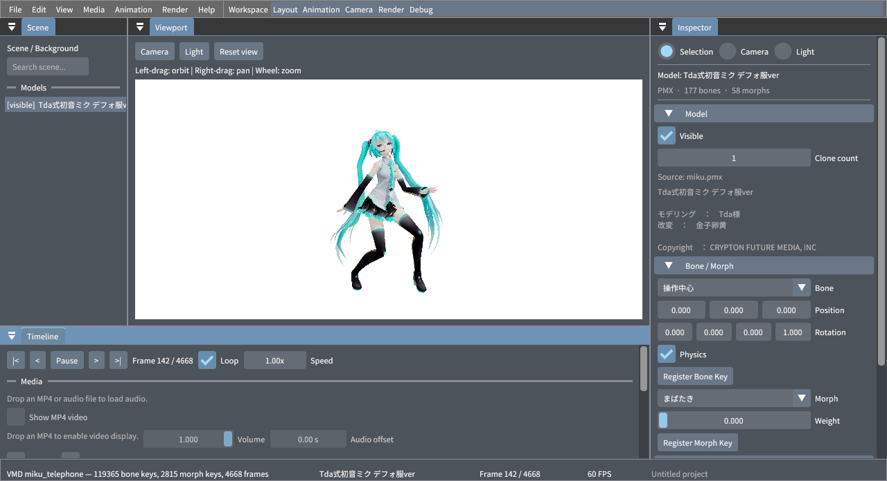
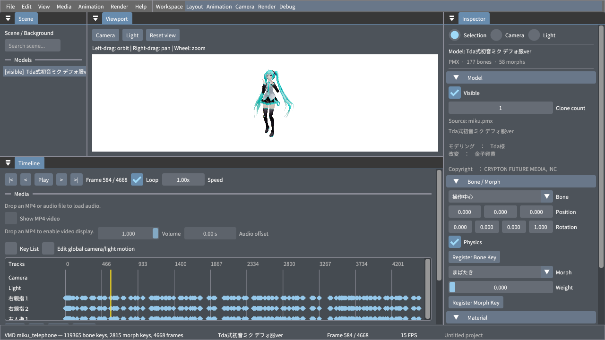
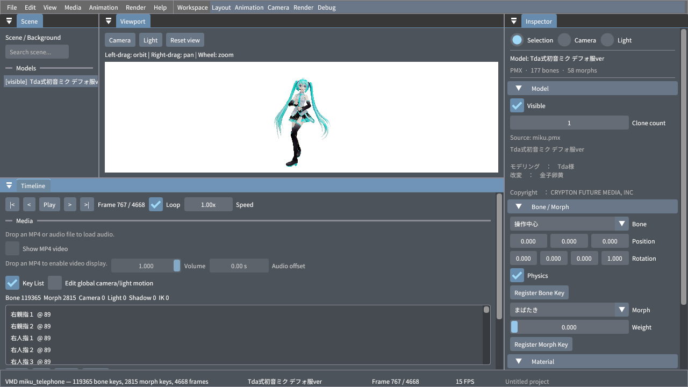
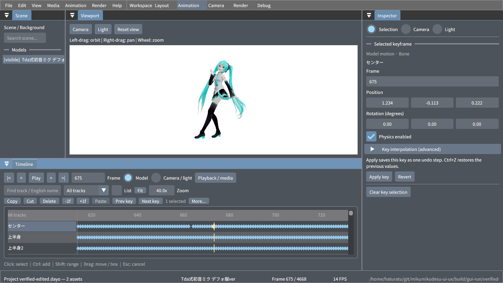
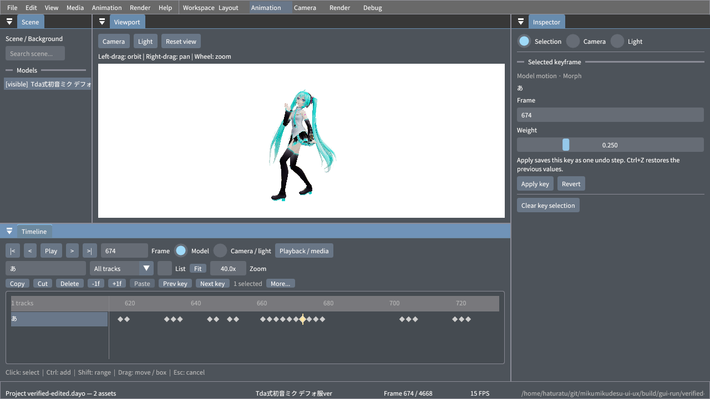
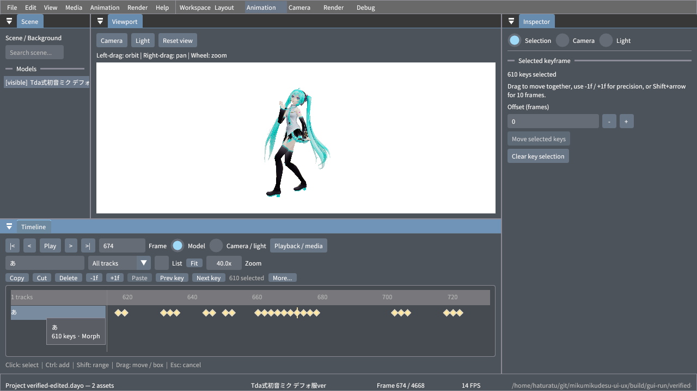

# キーフレームエディタの操作性と検証結果

Animation ワークスペースのキーフレーム編集について、変更前の問題、設計上の要件、実装内容、検証結果を記録します。

この記録は、Tda 式初音ミクとダンス・表情を組み合わせた VMD を使用した検証に基づきます。変更前後の画面は、下記のスクリーンショットで比較できます。

## 変更前の問題

119,365 個のボーンキーと 2,815 個のモーフキーを含むモーションを、1280 × 720 のウィンドウで操作して確認しました。

- 再生操作や常時展開されたメディア設定が領域を占め、タイムラインと編集ボタンを同時に表示しにくい状態でした。
- タイムライン上のキーをクリックしても再生位置が移動するだけで、キーを選択・ドラッグできませんでした。編集対象は 12 万個以上のキーを並べた別の一覧から探す必要がありました。
- キー一覧に検索やトラックの絞り込みがなく、選択しても Inspector の対象が切り替わりませんでした。
- ワークスペースを切り替えるボタンのクリック領域が重なり、後続の項目を操作できない場合がありました。
- 選択中のキー、ドラッグ可能な領域、操作が無効な理由が画面から読み取りにくい状態でした。

## 改善の要件

1280 × 720 の画面でも、再生操作、フレーム移動、編集操作とタイムラインを同時に使用できることを目標としました。

キーの検索、種類別の絞り込み、複数選択、ドラッグ移動、数値による編集を一つの作業領域で行えるようにします。ドラッグと Apply はそれぞれ一回の Undo 単位とし、Esc ではドラッグ中の変更を破棄します。

モデル固有のモーションとカメラなどの共通トラックは独立して扱い、既存の補間情報を保持します。また、キー数が多い場合でも通常の画面更新で毎回すべてのキーを処理しないことを要件としました。

## 実装した操作

### 画面の構成

`Animation` ワークスペースでは、再生・フレーム指定・検索・絞り込み・編集操作をタイムラインの上部にまとめています。再生速度とメディア設定は `Playback / media`、補間と書き出しは `More...` に配置しています。

タイムラインの表示領域を確保し、ワークスペース選択ボタンのクリック領域を分離しました。モデル・材質のプロパティは必要に応じて折り畳みます。

### キーの選択と移動

- キーのクリックで選択し、選択されたキーを金色で表示します。
- キーをドラッグすると移動先を示し、ボタンを離した時点で変更を確定します。`Esc` でキャンセルできます。
- `Ctrl` + クリックで選択を追加・解除し、`Shift` + クリックで同じトラック内の範囲を選択します。
- 空白部分からのドラッグで矩形選択し、`Ctrl+A` で現在の検索条件に一致するキーを全選択します。
- 目盛りでは再生位置を移動でき、ポインター位置を基準とするズーム、横スクロール、`Fit` に対応します。

日本語名に加え、モデルに英語名が設定されている場合はその名前でも検索できます。複数キーの移動では相対的な間隔を保ち、フレーム範囲の境界で移動量が制限された場合も、再生位置を不要に変更しません。

### Inspector による数値編集

キーを一つ選ぶと、そのキーが持つフィールドだけを Inspector に表示します。ボーン回転は度数法で入力でき、補間点と物理フラグを保持します。`Apply key` で一つの履歴として確定します。複数選択時はフレーム単位のオフセットで移動できます。

`Clear key selection` を選ぶと、Inspector はモデルのプロパティ表示に戻ります。有限でない数値は適用できません。

## 実機での確認

Tda 式初音ミク デフォ服 ver.（Tda / 金子卵黄）を使用し、1280 × 720 の X11 ウィンドウで実際のマウス・キーボード操作を確認しました。日本語トラック名の入力にはクリップボード貼り付けも使用しています。

| 操作 | 確認した結果 |
| --- | --- |
| Layout から Animation へ切り替え | 操作が可能で、再生・検索・編集ボタンとタイムラインを同時に表示 |
| センターキーをドラッグ | フレーム 665 → 673 に移動。Undo で復元し、Redo で再適用 |
| 選択キーを Inspector で編集 | フレームを 675、X 位置を 1.234 に設定して Apply。再生位置が追従 |
| `あ` で検索してモーフを編集 | フレーム 674 の重みを 0.800 → 0.250 に変更。Undo / Redo を確認 |
| 絞り込み後に `Ctrl+A` と一括移動 | `あ` の 610 個のキーを 1 フレーム移動し、Undo で復元 |
| プロジェクトを保存して再読込 | 119,365 ボーンキー、2,815 モーフキー、全 4,668 フレームを再読込 |
| 元データとの比較 | 変更対象のボーンキー 1 個とモーフキー 1 個以外の値・回転・補間点を保持 |
| カメラ VMD を追加してドラッグをキャンセル | 保存後のカメラキー 1,158 個は元データと一致 |

## 自動テストと制限

`keyframe_editor` の CTest は、GPU を使わず ImGui のマウス・キーイベントを再現します。選択、ドラッグ移動、Undo / Redo、キャンセル、複数選択、検索結果の全選択、無効になった選択の解除、全フレーム範囲の表示を確認します。

混在トラックの移動、フレーム範囲の下限・上限、重複参照、未編集トラック、補間の保持も対象です。

ビルド・テスト・sanitizer・format・clang-tidy の結果は [PR #267 の Checks](https://github.com/haturatu/mikumikudesu/pull/267/checks) に記録されています。ローカルでは主に操作確認と新しい入力テストのデバッグを実施しました。このページは検証時点の結果を記載したものであり、すべての OS・解像度で同じ操作性を保証するものではありません。
